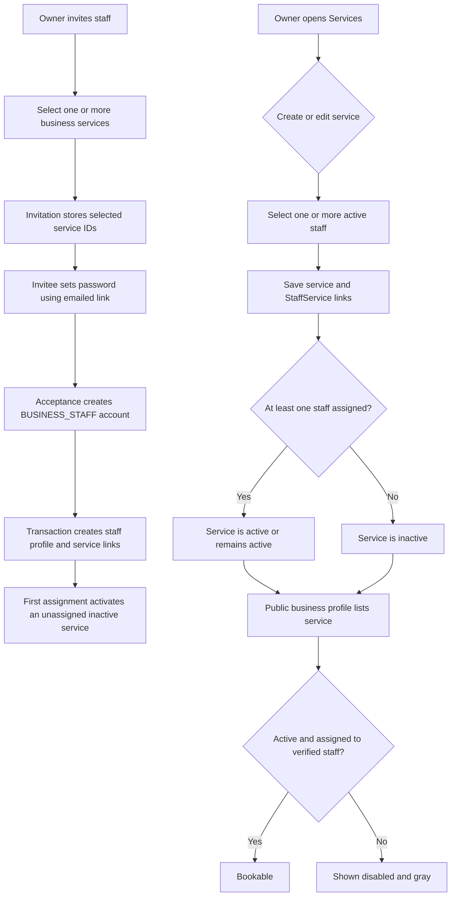

# Business Service and Staff Auto-Assignment Flow

This document describes how a business owner creates services, assigns staff, and invites staff with service assignments. It reflects the current implementation in the frontend and backend.

## At a Glance

## 1. Create a Business Service

The business owner opens **Services** and selects **Add Service**. The modal collects the service name, duration, optional expected price and description, plus staff assignments.

Staff selection behavior:

- If the business has exactly one active staff member, that member is selected by default for a new service.
- If there is more than one active staff member, the owner can select multiple people using the dropdown-style multi-select.
- If no staff member is selected, the service is still saved but is created inactive.
- The service editor sends the selected staff IDs in `staffIds` with the service fields.

The frontend calls `POST /api/business/services` for creation and `PUT /api/business/services/:serviceId` for edits. Both endpoints require an authenticated `BUSINESS_OWNER` session. The backend derives the business from the session, verifies that every selected staff ID belongs to that business, and saves the service and its `StaffService` assignment rows transactionally.

A newly created service is active only if at least one staff member is assigned. Editing replaces the service's complete staff assignment list with the submitted list. If the service previously had no assignments, adding its first staff member activates it. If it already had assignments, its active or intentionally paused state is preserved during an edit.

## 2. Invite Staff with Service Assignments

The owner opens **Staff** and selects **Invite Staff Member**. The form collects the invitee's name, email, optional phone, role/title, and zero or more business services.

- With one service available, the form shows a direct selection control.
- With multiple services, it shows a dropdown-style multi-select.
- Selecting no services is allowed; those assignments can be made later from the service editor.
- The owner can invite the person before the service assignment becomes active. Choosing a service on the form is a pending assignment, not a live `StaffService` relationship yet.

The frontend sends `fullName`, `email`, optional `phone`, `title`, and `serviceIds` to `POST /api/business/staff/invitations`. The backend verifies that the services belong to the owner's business, checks for an existing user or pending invitation, and counts pending invitations against the subscription staff limit. It stores the selected IDs on `StaffInvitation.serviceIds` and sends a single-use link by email. The link expires after seven days; only a hash of the token is stored.

Pending invitees appear in the owner's staff list with **Pending** status and the selected service names. They do not count as active staff assignments before acceptance.

## 3. Invitee Accepts and Assignments Become Active

The invitee opens `/accept-staff-invitation?token=...`, chooses a password that meets the password policy, and submits it to `POST /api/auth/accept-staff-invitation`.

The backend performs the following in one database transaction:

1. Hashes the presented token and looks up the invitation.
2. Rejects a missing, expired, or previously accepted invitation.
3. Checks that no user account already exists for the invitation email.
4. Revalidates that all selected service IDs still belong to the invited business.
5. Marks the invitation accepted, creates a verified `BUSINESS_STAFF` user, and creates the `BusinessStaff` profile.
6. Creates one `StaffService` row for each selected service.
7. Activates any selected service that was inactive and had no staff assignments before this invite was accepted.

The transaction uses an extended acquisition wait and timeout for the pooled database connection. If account creation or assignment fails, the transaction rolls back so there is no partially created staff account or partial assignment.

After acceptance, the invitee signs in normally. Login returns the `BUSINESS_STAFF` role and creates the standard session cookie. The staff dashboard reads that authenticated user through the shared auth context.

## 4. Public Business Services and Bookability

Public business profiles include all business services, including inactive or unassigned ones, so customers can see the catalog. Each service includes `assigned` and `bookable` flags.

- `assigned` is true when the service has at least one assigned staff account whose email is verified.
- `bookable` is true only when the service is active and has verified assigned staff.
- An unassigned service is rendered in a gray, disabled state with **No staff assigned**. It has no booking action.
- An assigned but inactive service is also disabled, with **Currently unavailable**.
- Availability hours are calculated only from active services and verified assigned staff availability.

The public API remains authoritative: the UI's disabled state is not a substitute for backend validation when a booking is submitted.

## API and Data Summary

| Purpose | Endpoint / model |
|---|---|
| List business services and assigned staff | `GET /api/business/services` |
| Create service with staff assignments | `POST /api/business/services` |
| Edit service and replace staff assignments | `PUT /api/business/services/:serviceId` |
| Activate/deactivate service | `PATCH /api/business/services/:serviceId/toggle` |
| List active staff and pending invitations | `GET /api/business/staff` |
| Invite staff with selected service IDs | `POST /api/business/staff/invitations` |
| Accept invite and create staff account/assignments | `POST /api/auth/accept-staff-invitation` |
| Persist staff-to-service relationship | `StaffService` (`staffId`, `serviceId`, unique pair) |
| Persist assignments selected for a pending invite | `StaffInvitation.serviceIds` |

## Operational Notes

- The migration adding `StaffInvitation.serviceIds` must be deployed to the target database before the updated invitation flow can be used.
- Existing services with no assigned staff remain inactive and non-bookable until the owner assigns staff.
- A service can have multiple staff members, and a staff member can be assigned to multiple services.
- The owner can change assignments after onboarding by editing the service or using the staff assignment controls.
